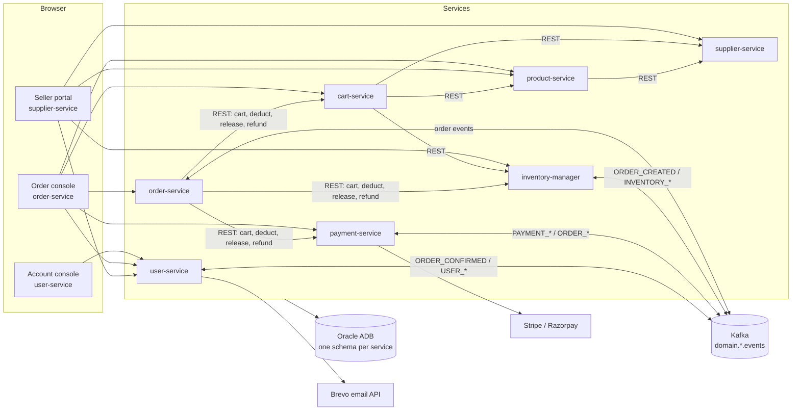
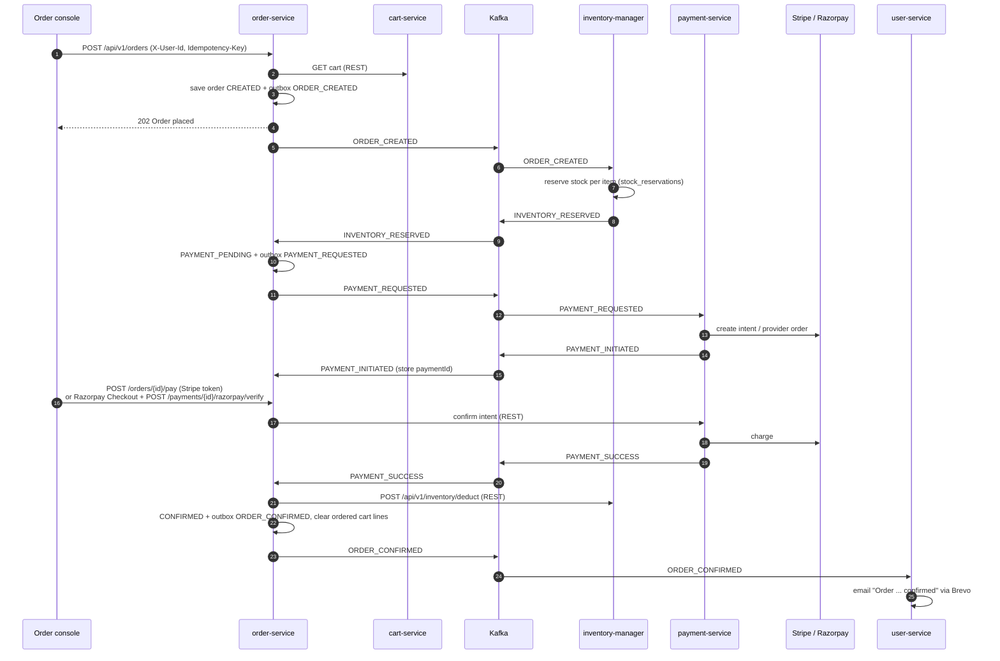

# ShopTrail

**A microservices backend for a multi-seller e-commerce marketplace.** Customers browse, add to cart and check out; suppliers onboard, list products and manage warehouse stock. Seven independently deployed Spring Boot services, each with its own database schema, coordinated through Kafka events and REST.

This repository is the home of the project. It holds the documentation and links every service repository as a git submodule. Each service keeps its own repository, CI pipeline and deployment.

## Architecture



## Services

| Service | Code | Responsibility | Schema | Swagger UI | OpenAPI | Health |
|---|---|---|---|---|---|---|
| **User** | [`user-service/`](user-service) · [repo](https://github.com/RaghuMHulkoti/user_service) | Accounts, JWT sign-in, profile, addresses, roles, emails | `USERS` | [user-service-xy69.onrender.com/swagger-ui.html](https://user-service-xy69.onrender.com/swagger-ui.html) | [JSON](https://user-service-xy69.onrender.com/v3/api-docs) | [status](https://user-service-xy69.onrender.com/actuator/health) |
| **Order** | [`order-service/`](order-service) · [repo](https://github.com/RaghuMHulkoti/order_service) | Checkout saga and order lifecycle | `ORDERS` | [order-service-nf43.onrender.com/swagger-ui.html](https://order-service-nf43.onrender.com/swagger-ui.html) | [JSON](https://order-service-nf43.onrender.com/v3/api-docs) | [status](https://order-service-nf43.onrender.com/actuator/health) |
| **Payment** | [`payment-service/`](payment-service) · [repo](https://github.com/RaghuMHulkoti/payment_service) | Stripe and Razorpay, refunds, webhooks, reconciliation | `PAYMENT` | [payment-service-iyeh.onrender.com/swagger-ui.html](https://payment-service-iyeh.onrender.com/swagger-ui.html) | [JSON](https://payment-service-iyeh.onrender.com/v3/api-docs) | [status](https://payment-service-iyeh.onrender.com/actuator/health) |
| **Cart** | [`cart-service/`](cart-service) · [repo](https://github.com/RaghuMHulkoti/cart_service) | Carts priced from supplier offers | `CART` | [cart-service-csoc.onrender.com/swagger-ui.html](https://cart-service-csoc.onrender.com/swagger-ui.html) | [JSON](https://cart-service-csoc.onrender.com/v3/api-docs) | [status](https://cart-service-csoc.onrender.com/actuator/health) |
| **Product** | [`product-service/`](product-service) · [repo](https://github.com/RaghuMHulkoti/product_service) | Catalogue: products, brands, categories, media | `PRODUCT` | [product-service-1o2l.onrender.com/swagger-ui.html](https://product-service-1o2l.onrender.com/swagger-ui.html) | [JSON](https://product-service-1o2l.onrender.com/v3/api-docs) | [status](https://product-service-1o2l.onrender.com/actuator/health) |
| **Inventory** | [`inventory-service/`](inventory-service) · [repo](https://github.com/RaghuMHulkoti/inventory-manager) | Stock per warehouse, reservations, ledger | `INVENTORY` | [inventory-manager-8q64.onrender.com/swagger-ui.html](https://inventory-manager-8q64.onrender.com/swagger-ui.html) | [JSON](https://inventory-manager-8q64.onrender.com/v3/api-docs) | [status](https://inventory-manager-8q64.onrender.com/actuator/health) |
| **Supplier** | [`supplier-service/`](supplier-service) · [repo](https://github.com/RaghuMHulkoti/supplier-service) | Suppliers, KYC, warehouses, offers | `SUPPLIER` | [supplier-service-tha0.onrender.com/swagger-ui.html](https://supplier-service-tha0.onrender.com/swagger-ui.html) | [JSON](https://supplier-service-tha0.onrender.com/v3/api-docs) | [status](https://supplier-service-tha0.onrender.com/actuator/health) |

Every API is live and can be tried from its Swagger UI. The services run on Render's free tier, so the first request after a quiet period can take about a minute while the service wakes up. Each service has its own README with setup, configuration, endpoints, tables, events and known gaps.

## Test consoles

> **For testing only.** These pages were built to exercise the backend APIs end to end from a browser: sign-up and sign-in, the full checkout saga with test payments, and seller onboarding. They are not the product's frontend. **A dedicated frontend has not been built yet**; ShopTrail is a backend project.

| Console | URL | Used to test |
|---|---|---|
| Accounts | https://user-service-xy69.onrender.com/console.html | Sign-up, email verification, sign-in and refresh, profile, addresses, payment methods, consent, password reset, admin role management |
| Orders | https://order-service-nf43.onrender.com/console.html | Catalogue, cart, placing an order, Stripe and Razorpay test payments, live saga timeline |
| Sellers | https://supplier-service-tha0.onrender.com/supplier.html | Supplier, warehouses, products, offers and stock upload (requires a `SUPPLIER`, `OPS` or `ADMIN` account) |

Each console is plain HTML, CSS and JavaScript served by its own service, and calls the live APIs directly. Payments run in test mode only (Stripe `pm_card_visa`; Razorpay card `4100 2800 0000 1007`, expiry `12/26`, CVV `123`). No real money moves.

## Checkout saga

The order service orchestrates checkout across inventory and payment with Kafka events, a transactional outbox, idempotent consumers and dead-letter topics. Every failure path has a compensation: stock is released, payment is retried, or the customer is refunded.



## Observability

Every service exposes Micrometer metrics at `/actuator/prometheus`. Grafana Alloy scrapes the live services and ships the metrics to Grafana Cloud.

| View | Link | Shows |
|---|---|---|
| Platform dashboard | [E-Commerce Microservices: Full Platform](https://sunnylinden3537.grafana.net/d/ecommerce-microservices/e-commerce-microservices-full-platform?from=now-7d&to=now&timezone=browser&var-datasource=grafanacloud-prom&var-application=$__all&var-instance=$__all&refresh=30s) | 135 panels: services up, request rate, 4xx/5xx errors, p50/p95/p99 latency, slowest and busiest endpoints, JVM heap and GC, DB connection pools, business flow |
| Grafana Cloud observability | [sunnylinden3537.grafana.net/observability](https://sunnylinden3537.grafana.net/observability) | Service overview in Grafana Cloud |

> The Grafana stack is private, so these links ask for a Grafana sign-in. Access is available on request.

## Engineering highlights

- **Distributed transactions:** orchestrated saga with compensation for payment failures, timeouts and stock lost after payment.
- **Reliable messaging:** transactional outbox (`FOR UPDATE SKIP LOCKED` pollers), inbox deduplication, retries and dead-letter topics; 7 topics fit a 10-topic / 64-partition Kafka quota.
- **Payments:** Stripe and Razorpay (test mode), idempotent intents, server-side signature verification, webhooks, scheduled reconciliation, automatic refunds.
- **Security:** RS256 JWT, rotating refresh tokens with reuse detection, BCrypt, account lockout, roles (`CUSTOMER`, `SUPPLIER`, `OPS`, `ADMIN`), JWKS endpoint.
- **Data:** schema per service on Oracle Autonomous Database, 43 tables versioned with Flyway, optimistic locking, idempotency keys.
- **Email:** welcome, email verification, password reset and order confirmation, sent from outbox events through Brevo.
- **Observability:** Micrometer and Prometheus metrics on every service, Grafana Alloy to Grafana Cloud, a 135-panel Grafana dashboard.
- **Delivery:** Docker images on Render; GitHub Actions run tests, container smoke tests and image publishing; protected `main` with required checks and owner approval.

## Tech stack

Java 21/25 · Spring Boot 3.5/4.x · Spring Security · Spring Data JPA · Apache Kafka · Oracle Autonomous Database · Flyway · Docker · GitHub Actions · Render · Prometheus · Grafana · Stripe · Razorpay · Brevo

## Get the code

```bash
git clone --recursive https://github.com/RaghuMHulkoti/shoptrail.git
cd shoptrail
git submodule update --remote --merge   # move every service to its latest main
```

Each folder is a full checkout of that service's repository. Changes are committed and pushed inside the service folder, to that service's repository.

## Documentation

- [Architecture and reference](docs/marketplace_tdd.md): services, setup and environment variables, security model, Kafka topics and events, flows, all 91 endpoints, every table with ER diagrams, known gaps.
- Each service's `README.md`.

## Repository layout

```
shoptrail/
├── docs/marketplace_tdd.md   architecture and reference
├── user-service/             submodule → user_service
├── order-service/            submodule → order_service
├── payment-service/          submodule → payment_service
├── cart-service/             submodule → cart_service
├── product-service/          submodule → product_service
├── inventory-service/        submodule → inventory-manager
└── supplier-service/         submodule → supplier-service
```
