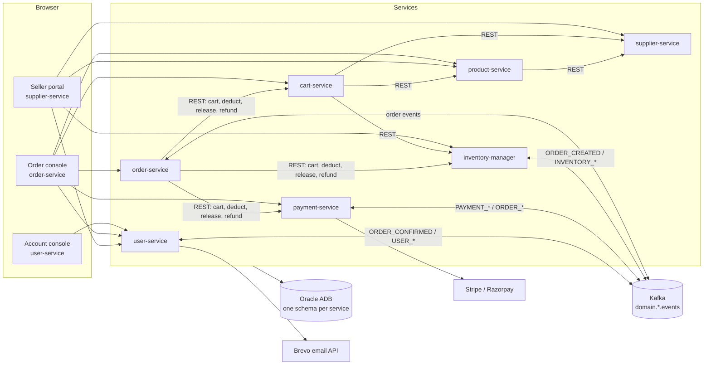
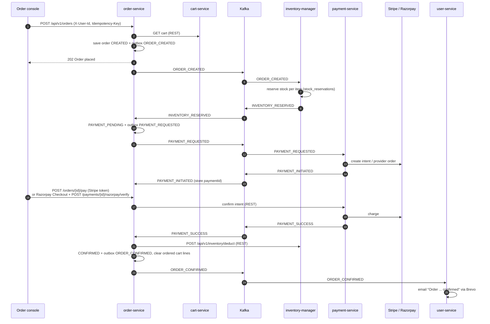

# ShopTrail

**A microservices backend for a multi-seller e-commerce marketplace.** Customers browse, add to cart and check out; suppliers onboard, list products and manage warehouse stock. Seven independently deployed Spring Boot services, each with its own database schema, coordinated through Kafka events and REST.

This repository is the home of the project. It holds the documentation and links every service repository as a git submodule. Each service keeps its own repository, CI pipeline and deployment.

## Architecture



## Services

| Service | Code | Responsibility | Schema | Live API |
|---|---|---|---|---|
| **User** | [`user-service/`](user-service) · [repo](https://github.com/RaghuMHulkoti/user_service) | Accounts, JWT sign-in, profile, addresses, roles, emails | `USERS` | [Swagger](https://user-service-xy69.onrender.com/swagger-ui.html) · [Health](https://user-service-xy69.onrender.com/actuator/health) |
| **Order** | [`order-service/`](order-service) · [repo](https://github.com/RaghuMHulkoti/order_service) | Checkout saga and order lifecycle | `ORDERS` | [Swagger](https://order-service-nf43.onrender.com/swagger-ui.html) · [Health](https://order-service-nf43.onrender.com/actuator/health) |
| **Payment** | [`payment-service/`](payment-service) · [repo](https://github.com/RaghuMHulkoti/payment_service) | Stripe and Razorpay, refunds, webhooks, reconciliation | `PAYMENT` | [Swagger](https://payment-service-iyeh.onrender.com/swagger-ui.html) · [Health](https://payment-service-iyeh.onrender.com/actuator/health) |
| **Cart** | [`cart-service/`](cart-service) · [repo](https://github.com/RaghuMHulkoti/cart_service) | Carts priced from supplier offers | `CART` | [Swagger](https://cart-service-csoc.onrender.com/swagger-ui.html) · [Health](https://cart-service-csoc.onrender.com/actuator/health) |
| **Product** | [`product-service/`](product-service) · [repo](https://github.com/RaghuMHulkoti/product_service) | Catalogue: products, brands, categories, media | `PRODUCT` | [Swagger](https://product-service-1o2l.onrender.com/swagger-ui.html) · [Health](https://product-service-1o2l.onrender.com/actuator/health) |
| **Inventory** | [`inventory-service/`](inventory-service) · [repo](https://github.com/RaghuMHulkoti/inventory-manager) | Stock per warehouse, reservations, ledger | `INVENTORY` | [Swagger](https://inventory-manager-8q64.onrender.com/swagger-ui.html) · [Health](https://inventory-manager-8q64.onrender.com/actuator/health) |
| **Supplier** | [`supplier-service/`](supplier-service) · [repo](https://github.com/RaghuMHulkoti/supplier-service) | Suppliers, KYC, warehouses, offers | `SUPPLIER` | [Swagger](https://supplier-service-tha0.onrender.com/swagger-ui.html) · [Health](https://supplier-service-tha0.onrender.com/actuator/health) |

Each service has its own README with setup, configuration, endpoints, tables, events and known gaps.

## Checkout saga

The order service orchestrates checkout across inventory and payment with Kafka events, a transactional outbox, idempotent consumers and dead-letter topics. Every failure path has a compensation: stock is released, payment is retried, or the customer is refunded.



## Engineering highlights

- **Distributed transactions:** orchestrated saga with compensation for payment failures, timeouts and stock lost after payment.
- **Reliable messaging:** transactional outbox (`FOR UPDATE SKIP LOCKED` pollers), inbox deduplication, retries and dead-letter topics; 7 topics fit a 10-topic / 64-partition Kafka quota.
- **Payments:** Stripe and Razorpay (test mode), idempotent intents, server-side signature verification, webhooks, scheduled reconciliation, automatic refunds.
- **Security:** RS256 JWT, rotating refresh tokens with reuse detection, BCrypt, account lockout, roles (`CUSTOMER`, `SUPPLIER`, `OPS`, `ADMIN`), JWKS endpoint.
- **Data:** schema per service on Oracle Autonomous Database, 43 tables versioned with Flyway, optimistic locking, idempotency keys.
- **Email:** welcome, email verification, password reset and order confirmation, sent from outbox events through Brevo.
- **Observability:** Micrometer and Prometheus metrics on every service, Grafana Alloy to Grafana Cloud, a 135-panel Grafana dashboard.
- **Delivery:** Docker images on Render; GitHub Actions run tests, container smoke tests and image publishing; protected `main` with required checks and owner approval.

## Tech stack

Java 21/25 · Spring Boot 3.5/4.x · Spring Security · Spring Data JPA · Apache Kafka · Oracle Autonomous Database · Flyway · Docker · GitHub Actions · Render · Prometheus · Grafana · Stripe · Razorpay · Brevo

## Get the code

```bash
git clone --recursive https://github.com/RaghuMHulkoti/shoptrail.git
cd shoptrail
git submodule update --remote --merge   # move every service to its latest main
```

Each folder is a full checkout of that service's repository. Changes are committed and pushed inside the service folder, to that service's repository.

## Documentation

- [Architecture and reference](docs/marketplace_tdd.md): services, setup and environment variables, security model, Kafka topics and events, flows, all 91 endpoints, every table with ER diagrams, known gaps.
- Each service's `README.md`.

## Repository layout

```
shoptrail/
├── docs/marketplace_tdd.md   architecture and reference
├── user-service/             submodule → user_service
├── order-service/            submodule → order_service
├── payment-service/          submodule → payment_service
├── cart-service/             submodule → cart_service
├── product-service/          submodule → product_service
├── inventory-service/        submodule → inventory-manager
└── supplier-service/         submodule → supplier-service
```
