# ShopTrail: As-Built Architecture and Reference

ShopTrail is a multi-seller marketplace: suppliers list products, keep stock in warehouses, and customers buy through one checkout.
This document describes the system **as it is built and deployed today**: services, setup, every endpoint, every database table, the events, and the main flows.
The earlier forward-looking design (the "target architecture") is kept in the git history of `marketplace_tdd.md` in the [inventory-manager](https://github.com/RaghuMHulkoti/inventory-manager) repository, before commit `f276541`.

## Contents

1. [System overview](#1-system-overview)
2. [Services and deployment](#2-services-and-deployment)
3. [Setup and configuration](#3-setup-and-configuration)
4. [Security model](#4-security-model)
5. [Events and Kafka](#5-events-and-kafka)
6. [Flows](#6-flows)
7. [API reference (every endpoint)](#7-api-reference)
8. [Data model (every table, ER diagrams)](#8-data-model)
9. [Web consoles](#9-web-consoles)
10. [Known gaps](#10-known-gaps)

---

## 1. System overview

Seven Spring Boot services, one Oracle Autonomous Database (one schema per service), one Kafka cluster for the order saga, Brevo for email, Stripe and Razorpay (test mode) for payments.

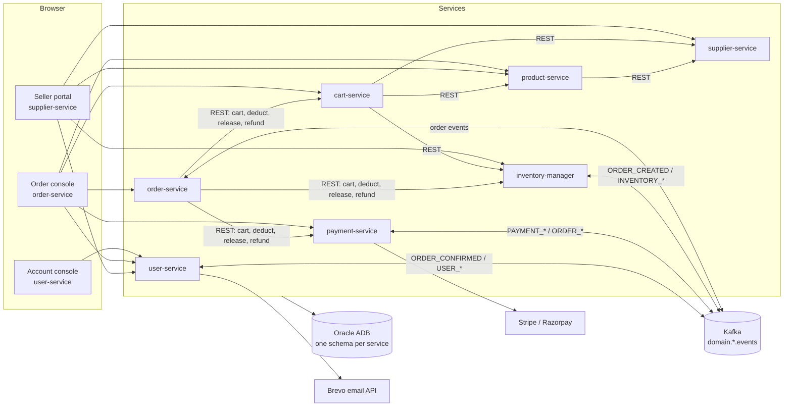

**Patterns used everywhere**

| Pattern | Where | How |
|---|---|---|
| Schema per service | all | Each service owns one Oracle schema and migrates it with Flyway. No service reads another's tables. |
| Transactional outbox | order, payment, inventory, user (supplier writes rows only) | The state change and the event row are written in one transaction. A poller publishes rows with `SELECT ... FOR UPDATE SKIP LOCKED`, so several replicas can run. |
| Inbox / idempotent consumers | order (`inbox_events`), payment, inventory | Event ids are recorded so a redelivered event is applied once. |
| Dead-letter topics | order, inventory, payment consumers | Failed events retry (50 ms, 250 ms, 1250 ms) and then go to `<topic>.dlq`. |
| Idempotency keys | order placement, registration, address and payment-method creation, payment intents, refunds | `Idempotency-Key` header or key column with a unique constraint; a repeat returns the first result. |
| Optimistic locking | most aggregates | `version` column. |
| Orchestrated saga | order-service | Order service drives reserve, pay, confirm or compensate, through Kafka events plus a few synchronous REST calls. |

---

## 2. Services and deployment

All services run on Render (Docker, free tier). Deploys are triggered manually or by the Render CLI.

| Service | Repo folder | Render URL | Local port | Schema | Responsibility |
|---|---|---|---|---|---|
| user-service | `user_service` | https://user-service-xy69.onrender.com | 8081 | `USERS` | Accounts, sign-in (JWT), profile, addresses, saved payment methods, consent, admin, emails |
| order-service | `order_service` | https://order-service-nf43.onrender.com | 8086 | `ORDERS` | Checkout saga and order lifecycle |
| payment-service | `payment_service` | https://payment-service-iyeh.onrender.com | 8085 | `PAYMENT` | Payment intents, Stripe and Razorpay, refunds, webhooks |
| cart-service | `cart_service` | https://cart-service-csoc.onrender.com | 8084 | `CART` | Shopping cart, priced from supplier offers |
| product-service | `product_service` | https://product-service-1o2l.onrender.com | 8082 | `PRODUCT` | Catalogue: products, brands, categories, media |
| inventory-manager | `inventory-manager` | https://inventory-manager-8q64.onrender.com | 8080 | `INVENTORY` | Stock per warehouse, reservations, ledger |
| supplier-service | `Projects` | https://supplier-service-tha0.onrender.com | 8080 | `SUPPLIER` | Suppliers, KYC, supplier warehouses, offers (price per product) |

Every service exposes `/actuator/health` (with liveness and readiness probes), Swagger UI at `/swagger-ui.html` (titled "ShopTrail ... Service API") and OpenAPI JSON at `/v3/api-docs`.

**Tech stack:** Java 25 and Spring Boot 4.1 (user, order, payment, cart, product), Java 21 and Spring Boot 4.0 (inventory), Java 21 and Spring Boot 3.5 (supplier); Spring Data JPA (Hibernate, `ddl-auto` none or validate), Flyway, Oracle JDBC with wallet, Spring Kafka, Micrometer (Prometheus and OTLP), OpenTelemetry, springdoc. user-service adds Spring Security (OAuth2 resource server, Nimbus JWT) and optional Redis.

**CI:** each repo has `.github/workflows/maven.yml`: `mvn test`, then a Docker build and a smoke test that starts the container, then a push to `ghcr.io`.

---

## 3. Setup and configuration

### 3.1 Run a service locally

```bash
cd <service-folder>
export DB_PASSWORD=...                 # Oracle ADMIN password
export WALLET_DIR=/path/to/Wallet_ECOMMERCE
./mvnw spring-boot:run
```

Tests use H2 in Oracle mode and need no database: `./mvnw test`.
On JDK newer than 25, Lombok is pinned to `1.18.48` in the `pom.xml` files that needed it.

### 3.2 Environment variables

**Shared by every service**

| Variable | Purpose |
|---|---|
| `DB_USERNAME` | Oracle user (default `ADMIN`) |
| `DB_PASSWORD` | Oracle password (secret) |
| `WALLET_DIR` | Local wallet folder |
| `WALLET_CWALLET_B64` | On Render: base64 of the auto-login wallet, unpacked by `docker-entrypoint.sh` |
| `CORS_ALLOWED_ORIGINS` | Comma-separated browser origins allowed to call the API. Empty means no browser access. No trailing dot or slash. |
| `SERVER_PORT` | Port override |

**Kafka (order, payment, inventory, user)**

| Variable | Purpose |
|---|---|
| `KAFKA_BOOTSTRAP_SERVERS` | Cluster address |
| `KAFKA_USERNAME` / `KAFKA_PASSWORD` | SASL/PLAIN login (password is secret) |
| `KAFKA_SECURITY_PROTOCOL` | `SASL_SSL` (default) or `PLAINTEXT` for a local broker |
| `EVENTS_PUBLISHER` | `log` (print events, no broker) or `kafka` |
| `EVENTS_CONSUMER_ENABLED` | `true` to start the service's Kafka listeners |
| `EVENTS_CREATE_TOPICS` | `true` to create the service's topics at startup (order, payment, inventory) |

**Service to service URLs**

| Variable | Used by |
|---|---|
| `CART_SERVICE_URL` | order |
| `INVENTORY_SERVICE_URL` | order, cart |
| `PAYMENT_SERVICE_URL` | order |
| `PRODUCT_SERVICE_URL` | cart |
| `SUPPLIER_SERVICE_URL` | cart, product |

**payment-service**

| Variable | Purpose |
|---|---|
| `STRIPE_SECRET_KEY` | Stripe test key `sk_test_...`. Empty means simulated payments. |
| `STRIPE_WEBHOOK_SECRET` | Stripe webhook signing secret. Webhooks are rejected while empty. |
| `RAZORPAY_KEY_ID` / `RAZORPAY_KEY_SECRET` | Razorpay test keys. The secret never reaches the browser. |
| `RAZORPAY_WEBHOOK_SECRET` | Razorpay webhook secret |

**user-service**

| Variable | Default | Purpose |
|---|---|---|
| `JWT_PRIVATE_KEY_LOCATION` / `JWT_PUBLIC_KEY_LOCATION` | empty | PEM files (PKCS#8/X.509 or PKCS#1). On Render: `file:/etc/secrets/private.pem` and `file:/etc/secrets/public.pem`. Empty generates a temporary key at every start. |
| `JWT_ISSUER` | `http://user-service` | `iss` claim |
| `JWT_KEY_ID` | `user-service-key-1` | `kid` in the JWKS |
| `INTERNAL_SERVICE_TOKEN` | `change-me-internal-token` | Shared secret for `/api/v1/internal/**`. Always set your own. |
| `REFRESH_TOKEN_STORE` | `oracle` | `oracle` or `redis` |
| `MAIL_PROVIDER` | `log` | `log` prints mails; `brevo` sends them |
| `BREVO_API_KEY` | empty | Brevo API key (secret) |
| `MAIL_FROM_ADDRESS` / `MAIL_FROM_NAME` | empty / `ShopTrail` | Sender; the address must be verified in Brevo |
| `PUBLIC_BASE_URL` | `http://localhost:8081` | Links in mails open `<url>/console.html` |
| `REDIS_HEALTH_ENABLED` | `false` | Turn on the Redis health check when Redis exists |

Profile `dev` (set `SPRING_PROFILES_ACTIVE=dev`) prints verification and reset tokens to the log. It is never active by default; do not use it in production.

### 3.3 First admin

Registration always grants `CUSTOMER`. Make the first admin with SQL (see `user_service/README.md`), then manage roles from the Admin tab of the account console.

```sql
INSERT INTO USERS.user_roles (user_id, role_id)
SELECT u.id, r.id FROM USERS.users u, USERS.roles r
WHERE LOWER(u.email) = LOWER('you@example.com') AND r.code = 'ADMIN';
```

---

## 4. Security model

| Area | What is enforced |
|---|---|
| Sign-in | user-service issues RS256 JWT access tokens (15 min) and opaque refresh tokens (30 days, `jti.secret`, only a SHA-256 hash stored in `refresh_tokens`). Refresh rotates the token; reusing an old refresh token is refused and revokes the newer one. |
| Token claims | `sub` (user id), `roles` (e.g. `["CUSTOMER"]`), `tenantId` (`shoptrail`), `iss`, `exp`, `iat`, `jti`. Public keys at `/.well-known/jwks.json`. |
| Passwords | BCrypt (strength 12). At least 12 characters with three of: lower, upper, digit, symbol. Account locks for 15 min after 5 failed logins. |
| Password change and reset | Revoke every refresh token of the user. |
| user-service API | `/api/v1/users/me/**` needs a valid JWT. `/api/v1/admin/**` needs role `ADMIN` or `OPS`. `/api/v1/internal/**` needs the `INTERNAL_SERVICE_TOKEN`. Register, login, refresh, verify, reset, JWKS and the console page are public. |
| Rate limits | Login per IP and per account, password reset per account. Stored in Redis; without Redis they are skipped (fail open). |
| Other services | **No token check.** The customer is identified by the `X-User-Id` header. The order console sends the signed-in user's id. |
| Seller portal | The page lets in only `SUPPLIER`, `OPS` or `ADMIN` accounts. This is a UI check; the supplier, product and inventory APIs are open. |
| Payments | Razorpay payments are verified by HMAC signature on the server. Stripe and Razorpay webhooks need their signing secrets. |
| CORS | Opt-in per service with `CORS_ALLOWED_ORIGINS`. |

---

## 5. Events and Kafka

The free cluster allows 10 topics and 64 partitions. Seven topics are used, 3 partitions each.

| Topic | Producer | Consumers |
|---|---|---|
| `domain.order.events` | order-service | inventory-manager, payment-service, user-service |
| `domain.inventory.events` | inventory-manager | order-service |
| `domain.payment.events` | payment-service | order-service |
| `domain.user.events` | user-service | (none yet) |
| `domain.order.events.dlq`, `domain.inventory.events.dlq`, `domain.payment.events.dlq` | consumer error handlers | (inspect manually) |

Messages are keyed by the aggregate id (order id or user id), so events of one order stay in order.

**Envelope**

```json
{
  "eventId": "uuid",
  "eventType": "ORDER_CONFIRMED",
  "occurredAt": "2026-10-19T13:53:40Z",
  "producer": "order-service",
  "version": 1,
  "traceId": "request trace id",
  "data": { "...": "event specific" }
}
```

**Event catalogue**

| Event | Producer | Data | Consumed by |
|---|---|---|---|
| `ORDER_CREATED` | order | orderId, orderNumber, customerId, totalAmount, currency, paymentProvider, reservationTtlSeconds, items | inventory: reserve stock |
| `PAYMENT_REQUESTED` | order | orderId, customerId, amount, currency, provider | payment: create intent |
| `ORDER_CONFIRMED` | order | orderId, orderNumber, customerId, status, total, currency, items (title, quantity, unitPrice) | user: confirmation email |
| `ORDER_CANCELLED`, `ORDER_FAILED` | order | orderId, ..., reason | payment: cancel open intents |
| `INVENTORY_RESERVED` | inventory | orderId, reservations per item | order: move to PAYMENT_PENDING |
| `INVENTORY_RESERVATION_FAILED` | inventory | orderId, reason | order: fail the order |
| `PAYMENT_INITIATED` | payment | orderId, paymentId, provider, client secret or provider order id | order: store payment id |
| `PAYMENT_SUCCESS` | payment | orderId, paymentId, amount | order: confirm |
| `PAYMENT_FAILED` | payment | orderId, paymentId, failure | order: allow retry or fail |
| `USER_REGISTERED`, `USER_UPDATED`, `USER_DELETED`, `ADDRESS_UPDATED`, `EMAIL_VERIFICATION_REQUESTED`, `PASSWORD_RESET_REQUESTED`, `PASSWORD_CHANGED` | user | user fields; verification and reset events carry the raw one-time token for the mail | user itself sends the mail before publishing |

supplier-service writes `OFFER_CREATED`, `OFFER_PRICE_UPDATED`, `OFFER_ACTIVATED`, `OFFER_DEACTIVATED`, `SUPPLIER_STATUS_UPDATED`, `SUPPLIER_KYC_SUBMITTED` and `SUPPLIER_WAREHOUSE_DECLARED` to `supplier_outbox`, but nothing relays them yet (topic quota).

---

## 6. Flows

### 6.1 Checkout saga (place, reserve, pay, confirm)

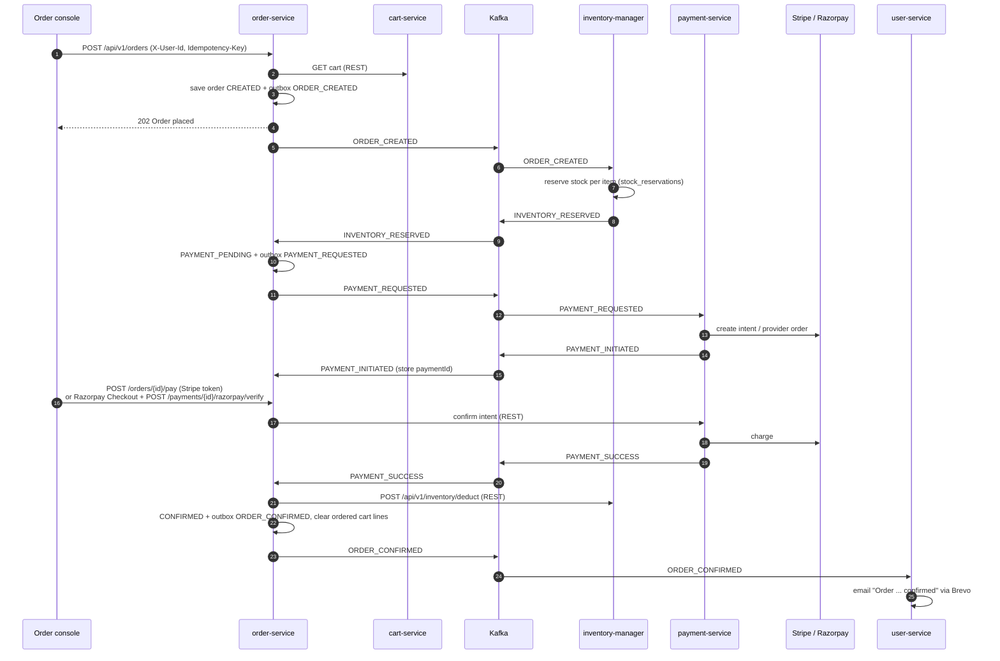

### 6.2 Order states

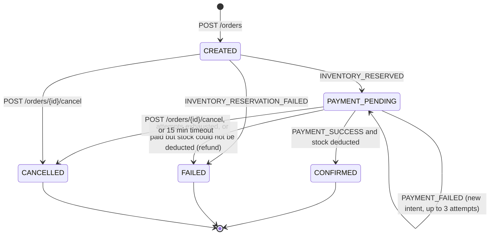

**Compensation rules**

- A failed or cancelled order releases its reservations (`POST /api/v1/inventory/release`).
- Payment cancels open intents when it sees `ORDER_CANCELLED` or `ORDER_FAILED`.
- Money captured after the order already ended is refunded automatically.
- If payment succeeds but stock can no longer be deducted, the order is refunded (`FULFILMENT_FAILED`) and fails.
- `OrderSettlementJob` is the fallback: it polls payment status and enforces the 15-minute payment timeout.

### 6.3 Registration, email verification and welcome mail

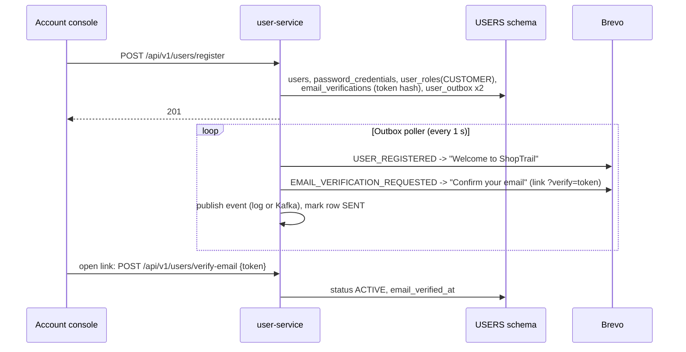

The mail is sent just before the event is published, with the same retry rules. A provider rejection (bad address or key) marks the row FAILED; any other failure retries on the next poll.

### 6.4 Sign-in, refresh, sign-out

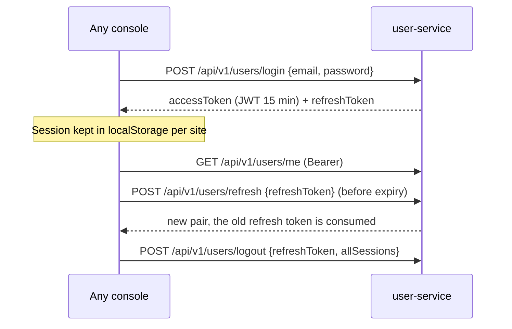

### 6.5 Password reset

1. `POST /api/v1/users/password/reset-request {email}`: always 202; if the account exists a reset token (30 min) is stored as a hash and `PASSWORD_RESET_REQUESTED` is written.
2. The mail links to `console.html?reset=<token>`; the console fills the token.
3. `POST /api/v1/users/password/reset {token, newPassword}`: sets the password and revokes all refresh tokens.

### 6.6 Seller onboarding and listing (seller portal)

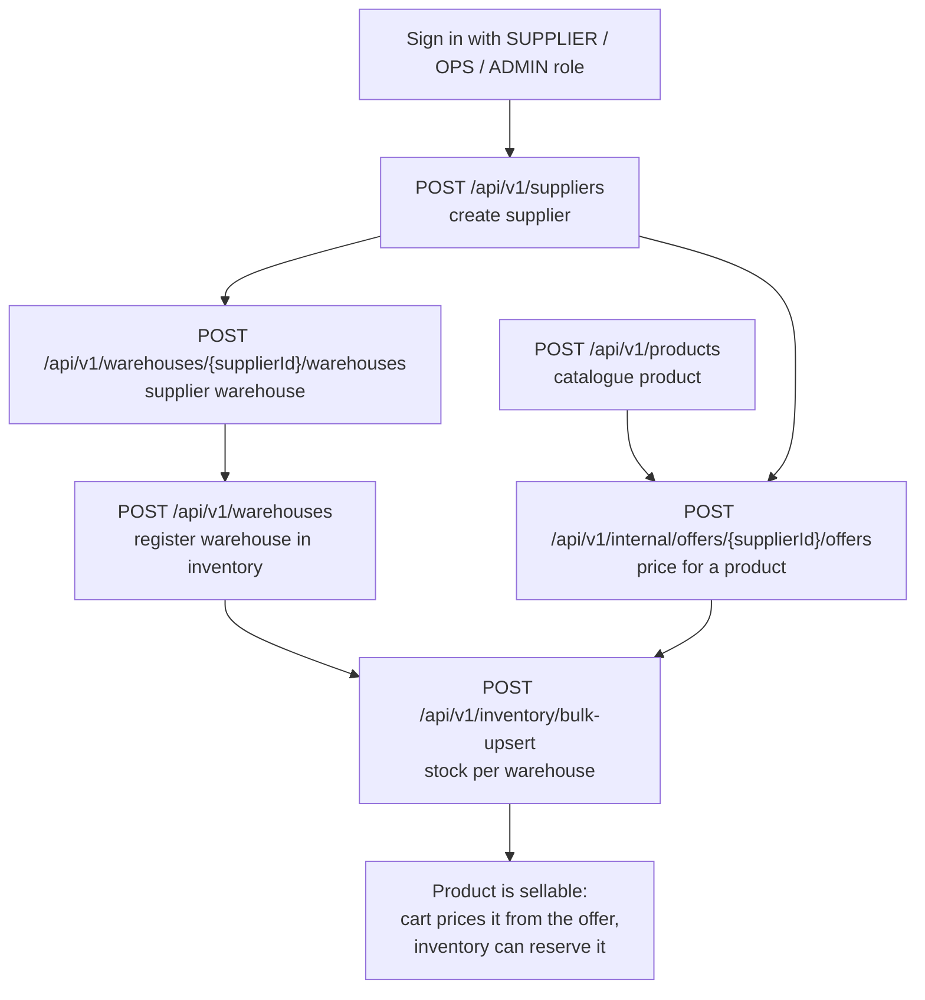

Products and suppliers are independent. A warehouse needs a supplier; an offer needs a supplier and a product; stock needs an offer (supplier product) and a warehouse.

### 6.7 Cart

`POST /api/v1/cart/items {productId, quantity}` with `X-User-Id`: cart-service fetches the product (product-service), the best active offer (supplier-service) and availability (inventory-manager), then stores the line with the offer's price and supplier. One line per product per user.

---

## 7. API reference

Responses of order, cart, product, payment, inventory and supplier are wrapped as `{"status": "SUCCESS", "message": "...", "body": {...}}`. user-service returns plain JSON and errors as `{"error": {"code", "message", "details"}}`.

### 7.1 user-service

| Method | Path | Auth | Purpose |
|---|---|---|---|
| POST | `/api/v1/users/register` | public, `Idempotency-Key` | Create account (status PENDING_VERIFICATION, role CUSTOMER) |
| POST | `/api/v1/users/verify-email` | public | Confirm email with token |
| POST | `/api/v1/users/verify-email/resend` | JWT | New verification token and mail |
| POST | `/api/v1/users/login` | public | Access and refresh token |
| POST | `/api/v1/users/refresh` | public | Rotate tokens |
| POST | `/api/v1/users/logout` | JWT | Revoke this or all sessions |
| POST | `/api/v1/users/password/reset-request` | public | Start password reset |
| POST | `/api/v1/users/password/reset` | public | Finish password reset |
| GET | `/api/v1/users/me` | JWT | Profile |
| PATCH | `/api/v1/users/me` | JWT | Update profile (send `version`) |
| DELETE | `/api/v1/users/me` | JWT | Delete account |
| POST | `/api/v1/users/me/password` | JWT | Change password |
| GET | `/api/v1/users/me/addresses` | JWT | List addresses |
| POST | `/api/v1/users/me/addresses` | JWT, `Idempotency-Key` | Add address |
| PATCH | `/api/v1/users/me/addresses/{id}` | JWT | Update address / make default |
| DELETE | `/api/v1/users/me/addresses/{id}` | JWT | Delete address |
| GET | `/api/v1/users/me/payment-methods` | JWT | List saved PSP tokens |
| POST | `/api/v1/users/me/payment-methods` | JWT, `Idempotency-Key` | Save PSP token |
| POST | `/api/v1/users/me/payment-methods/{id}/default` | JWT | Make default |
| DELETE | `/api/v1/users/me/payment-methods/{id}` | JWT | Remove |
| GET | `/api/v1/users/me/consents` | JWT | Current consent per kind |
| POST | `/api/v1/users/me/consents` | JWT | Record a consent decision |
| GET | `/api/v1/users/me/consents/history` | JWT | All consent decisions |
| GET | `/api/v1/admin/users` | ADMIN/OPS | Page of users, `?status=&page=&size=` |
| PUT | `/api/v1/admin/users/{id}/roles` | ADMIN/OPS | Replace roles |
| POST | `/api/v1/admin/users/{id}/suspend` | ADMIN/OPS | Suspend |
| POST | `/api/v1/admin/users/{id}/reactivate` | ADMIN/OPS | Reactivate |
| GET | `/api/v1/internal/users/{id}` | internal token | User lookup for other services |
| GET | `/.well-known/jwks.json` | public | Public signing keys |
| GET | `/console.html` | public | Account console |

### 7.2 order-service (header `X-User-Id`)

| Method | Path | Purpose |
|---|---|---|
| POST | `/api/v1/orders` | Place order from the cart. Body: `shippingAddress`, `provider` (`STRIPE` or `RAZORPAY`). Header `Idempotency-Key`. Returns 202. |
| GET | `/api/v1/orders` | The customer's orders |
| GET | `/api/v1/orders/{id}` | One order with items, status, payment id |
| POST | `/api/v1/orders/{id}/pay` | Pay with a token (`paymentMethodToken`, e.g. `pm_card_visa`) |
| POST | `/api/v1/orders/{id}/cancel` | Cancel an open order |
| GET | `/console.html` | Order console |

### 7.3 payment-service

| Method | Path | Purpose |
|---|---|---|
| GET | `/api/v1/payments/{id}` | Payment intent status |
| GET | `/api/v1/payments/{id}/checkout` | Razorpay Checkout data (provider order id, public key id, amount) |
| POST | `/api/v1/payments/{id}/razorpay/verify` | Verify Razorpay payment signature |
| POST | `/api/v1/internal/payments/intents` | Create intent (used by order) |
| POST | `/api/v1/internal/payments/intents/{id}/confirm` | Confirm intent with a token (used by order) |
| POST | `/api/v1/internal/payments/refunds` | Refund (used by order) |
| POST | `/api/v1/webhooks/stripe` | Stripe webhook (signature checked) |
| POST | `/api/v1/webhooks/razorpay` | Razorpay webhook (signature checked) |

### 7.4 cart-service (header `X-User-Id`)

| Method | Path | Purpose |
|---|---|---|
| GET | `/api/v1/cart` | Current cart with prices |
| POST | `/api/v1/cart/items` | Add a product `{productId, quantity}` |
| PATCH | `/api/v1/cart/items/{itemId}` | Change quantity |
| DELETE | `/api/v1/cart/items/{itemId}` | Remove a line |
| DELETE | `/api/v1/cart` | Empty the cart |
| POST | `/api/v1/cart/merge` | Merge a guest cart into the user's cart |

### 7.5 product-service

| Method | Path | Purpose |
|---|---|---|
| GET | `/api/v1/products` | Page of products |
| GET | `/api/v1/products/{productId}` | One product |
| POST | `/api/v1/products` | Create product |
| PATCH | `/api/v1/products/{productId}` | Update product |
| DELETE | `/api/v1/products/{productId}` | Delete (soft) |
| POST | `/api/v1/products/{productId}/media` | Add an image, video or document |
| GET | `/api/v1/brands` | Brands |
| POST | `/api/v1/brands` | Create brand |
| GET | `/api/v1/categories` | Category tree |
| GET | `/api/v1/categories/{slug}/products` | Products in a category |
| POST | `/api/v1/categories` | Create category |
| POST | `/api/v1/categories/{categoryId}/attributes` | Define a category attribute |
| GET | `/api/v1/internal/products/{productId}` | Product for other services |
| GET | `/api/v1/internal/products` | Products by ids for other services |

### 7.6 inventory-manager

| Method | Path | Purpose |
|---|---|---|
| POST | `/api/v1/warehouses` | Register a warehouse for stock |
| POST | `/api/v1/inventory/bulk-upsert` | Set stock for many supplier products (per-row results) |
| GET | `/api/v1/inventory/{supplierProductId}` | Stock across warehouses |
| GET | `/api/v1/inventory/availability` | Available quantity for products |
| POST | `/api/v1/inventory/reserve` | Reserve stock (also done from `ORDER_CREATED`) |
| POST | `/api/v1/inventory/release` | Release reservations (compensation) |
| POST | `/api/v1/inventory/deduct` | Commit reservations on confirmation |

### 7.7 supplier-service

| Method | Path | Purpose |
|---|---|---|
| POST | `/api/v1/suppliers` | Create supplier |
| GET | `/api/v1/suppliers/{supplierId}` | Supplier |
| PATCH | `/api/v1/suppliers/{supplierId}` | Update supplier or status |
| POST | `/api/v1/kyc/{supplierId}/kyc` | Submit KYC document |
| GET | `/api/v1/kyc/{supplierId}/kyc` | KYC status |
| POST | `/api/v1/warehouses/{supplierId}/warehouses` | Create supplier warehouse |
| GET | `/api/v1/warehouses/{supplierId}/warehouses` | List supplier warehouses |
| GET | `/api/v1/warehouses/{supplierId}/warehouses/{warehouseId}` | One warehouse |
| PATCH | `/api/v1/warehouses/{supplierId}/warehouses/{warehouseId}` | Update warehouse |
| PATCH | `/api/v1/warehouses/{supplierId}/warehouses/{warehouseId}/status` | Activate or deactivate |
| POST | `/api/v1/internal/offers/{supplierId}/offers` | Create offer (price for a product) |
| GET | `/api/v1/internal/offers/{supplierId}/offers` | Supplier's offers |
| GET | `/api/v1/internal/offers/{supplierId}/offers/{offerId}` | One offer |
| PATCH | `/api/v1/internal/offers/{supplierId}/offers/{offerId}` | Update price or status |
| GET | `/api/v1/internal/offers/{offerId}` | Offer by id (cart) |
| GET | `/api/v1/internal/offers?productId=` | Offers for a product (cart, product) |
| GET | `/supplier.html` | Seller portal |

---

## 8. Data model

One Oracle Autonomous Database, one schema per service. Ids are `RAW(16)` UUIDs unless noted. Cross-service ids (for example `orders.customer_id` to `users.id`) are **logical references only**; there are no foreign keys between schemas.

### 8.1 Cross-service references

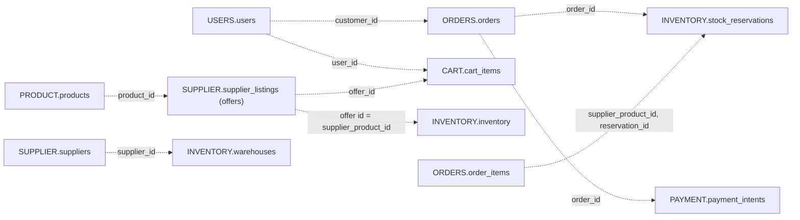

### 8.2 Tables per schema

The diagrams and tables below are generated from the Flyway migrations (`src/main/resources/db/migration`). Columns marked `[ALTER]` in the migrations are included.

### Schema `USERS` (user-service)

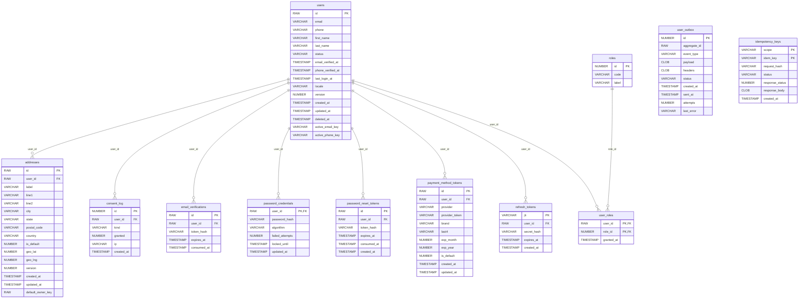

**`users`** (`V1__init_users_schema.sql`)

| Column | Type and rules | Key |
|---|---|---|
| `id` | RAW(16) DEFAULT SYS_GUID() NOT NULL | PK |
| `email` | VARCHAR2(255 CHAR) NOT NULL |  |
| `phone` | VARCHAR2(20 CHAR) |  |
| `first_name` | VARCHAR2(80 CHAR) NOT NULL |  |
| `last_name` | VARCHAR2(80 CHAR) |  |
| `status` | VARCHAR2(20 CHAR) DEFAULT 'PENDING_VERIFICATION' NOT NULL |  |
| `email_verified_at` | TIMESTAMP WITH TIME ZONE |  |
| `phone_verified_at` | TIMESTAMP WITH TIME ZONE |  |
| `last_login_at` | TIMESTAMP WITH TIME ZONE |  |
| `locale` | VARCHAR2(10 CHAR) DEFAULT 'en-IN' NOT NULL |  |
| `version` | NUMBER(19) DEFAULT 0 NOT NULL |  |
| `created_at` | TIMESTAMP WITH TIME ZONE DEFAULT SYSTIMESTAMP NOT NULL |  |
| `updated_at` | TIMESTAMP WITH TIME ZONE DEFAULT SYSTIMESTAMP NOT NULL |  |
| `deleted_at` | TIMESTAMP WITH TIME ZONE |  |
| `active_email_key` | VARCHAR2(255 CHAR) GENERATED ALWAYS AS (CASE WHEN deleted_at IS NULL THEN LOWER(email) END) |  |
| `active_phone_key` | VARCHAR2(20 CHAR) GENERATED ALWAYS AS (CASE WHEN deleted_at IS NULL THEN phone END) |  |

Constraints: `ck_users_status CHECK (status IN ('PENDING_VERIFICATION','ACTIVE','SUSPENDED','DELETED'))`

**`password_credentials`** (`V1__init_users_schema.sql`)

| Column | Type and rules | Key |
|---|---|---|
| `user_id` | RAW(16) NOT NULL | PK, FK to `users` |
| `password_hash` | VARCHAR2(255 CHAR) NOT NULL |  |
| `algorithm` | VARCHAR2(20 CHAR) DEFAULT 'BCRYPT' NOT NULL |  |
| `failed_attempts` | NUMBER(10) DEFAULT 0 NOT NULL |  |
| `locked_until` | TIMESTAMP WITH TIME ZONE |  |
| `updated_at` | TIMESTAMP WITH TIME ZONE DEFAULT SYSTIMESTAMP NOT NULL |  |

Constraints: `fk_pwd_cred_user FOREIGN KEY (user_id) REFERENCES users (id) ON DELETE CASCADE`

**`roles`** (`V1__init_users_schema.sql`)

| Column | Type and rules | Key |
|---|---|---|
| `id` | NUMBER(5) GENERATED BY DEFAULT AS IDENTITY NOT NULL | PK |
| `code` | VARCHAR2(40 CHAR) NOT NULL |  |
| `label` | VARCHAR2(80 CHAR) NOT NULL |  |

Constraints: `uq_roles_code UNIQUE (code)`

**`user_roles`** (`V1__init_users_schema.sql`)

| Column | Type and rules | Key |
|---|---|---|
| `user_id` | RAW(16) NOT NULL | PK, FK to `users` |
| `role_id` | NUMBER(5) NOT NULL | PK, FK to `roles` |
| `granted_at` | TIMESTAMP WITH TIME ZONE DEFAULT SYSTIMESTAMP NOT NULL |  |

Constraints: `fk_user_roles_user FOREIGN KEY (user_id) REFERENCES users (id) ON DELETE CASCADE`; `fk_user_roles_role FOREIGN KEY (role_id) REFERENCES roles (id)`

**`addresses`** (`V1__init_users_schema.sql`)

| Column | Type and rules | Key |
|---|---|---|
| `id` | RAW(16) DEFAULT SYS_GUID() NOT NULL | PK |
| `user_id` | RAW(16) NOT NULL | FK to `users` |
| `label` | VARCHAR2(40 CHAR) |  |
| `line1` | VARCHAR2(200 CHAR) NOT NULL |  |
| `line2` | VARCHAR2(200 CHAR) |  |
| `city` | VARCHAR2(100 CHAR) NOT NULL |  |
| `state` | VARCHAR2(100 CHAR) NOT NULL |  |
| `postal_code` | VARCHAR2(20 CHAR) NOT NULL |  |
| `country` | VARCHAR2(2 CHAR) NOT NULL |  |
| `is_default` | NUMBER(1) DEFAULT 0 NOT NULL CHECK (is_default IN (0, 1)) |  |
| `geo_lat` | NUMBER(9,6) |  |
| `geo_lng` | NUMBER(9,6) |  |
| `version` | NUMBER(19) DEFAULT 0 NOT NULL |  |
| `created_at` | TIMESTAMP WITH TIME ZONE DEFAULT SYSTIMESTAMP NOT NULL |  |
| `updated_at` | TIMESTAMP WITH TIME ZONE DEFAULT SYSTIMESTAMP NOT NULL |  |
| `default_owner_key` | RAW(16) GENERATED ALWAYS AS (CASE WHEN is_default = 1 THEN user_id END) |  |

Constraints: `fk_addresses_user FOREIGN KEY (user_id) REFERENCES users (id) ON DELETE CASCADE`

**`payment_method_tokens`** (`V1__init_users_schema.sql`)

| Column | Type and rules | Key |
|---|---|---|
| `id` | RAW(16) DEFAULT SYS_GUID() NOT NULL | PK |
| `user_id` | RAW(16) NOT NULL | FK to `users` |
| `provider` | VARCHAR2(20 CHAR) NOT NULL |  |
| `provider_token` | VARCHAR2(255 CHAR) NOT NULL |  |
| `brand` | VARCHAR2(20 CHAR) |  |
| `last4` | VARCHAR2(4 CHAR) |  |
| `exp_month` | NUMBER(2) |  |
| `exp_year` | NUMBER(4) |  |
| `is_default` | NUMBER(1) DEFAULT 0 NOT NULL CHECK (is_default IN (0, 1)) |  |
| `created_at` | TIMESTAMP WITH TIME ZONE DEFAULT SYSTIMESTAMP NOT NULL |  |
| `updated_at` | TIMESTAMP WITH TIME ZONE DEFAULT SYSTIMESTAMP NOT NULL |  |

Constraints: `fk_pmt_user FOREIGN KEY (user_id) REFERENCES users (id) ON DELETE CASCADE`

**`email_verifications`** (`V1__init_users_schema.sql`)

| Column | Type and rules | Key |
|---|---|---|
| `id` | RAW(16) DEFAULT SYS_GUID() NOT NULL | PK |
| `user_id` | RAW(16) NOT NULL | FK to `users` |
| `token_hash` | VARCHAR2(64 CHAR) NOT NULL |  |
| `expires_at` | TIMESTAMP WITH TIME ZONE NOT NULL |  |
| `consumed_at` | TIMESTAMP WITH TIME ZONE |  |

Constraints: `fk_email_verif_user FOREIGN KEY (user_id) REFERENCES users (id) ON DELETE CASCADE`

**`consent_log`** (`V1__init_users_schema.sql`)

| Column | Type and rules | Key |
|---|---|---|
| `id` | NUMBER(19) GENERATED BY DEFAULT AS IDENTITY NOT NULL | PK |
| `user_id` | RAW(16) NOT NULL | FK to `users` |
| `kind` | VARCHAR2(40 CHAR) NOT NULL |  |
| `granted` | NUMBER(1) NOT NULL CHECK (granted IN (0, 1)) |  |
| `ip` | VARCHAR2(45 CHAR) |  |
| `created_at` | TIMESTAMP WITH TIME ZONE DEFAULT SYSTIMESTAMP NOT NULL |  |

Constraints: `fk_consent_user FOREIGN KEY (user_id) REFERENCES users (id) ON DELETE CASCADE`

**`user_outbox`** (`V1__init_users_schema.sql`)

| Column | Type and rules | Key |
|---|---|---|
| `id` | NUMBER(19) GENERATED BY DEFAULT AS IDENTITY NOT NULL | PK |
| `aggregate_id` | RAW(16) NOT NULL |  |
| `event_type` | VARCHAR2(60 CHAR) NOT NULL |  |
| `payload` | CLOB NOT NULL |  |
| `headers` | CLOB |  |
| `status` | VARCHAR2(20 CHAR) DEFAULT 'PENDING' NOT NULL |  |
| `created_at` | TIMESTAMP WITH TIME ZONE DEFAULT SYSTIMESTAMP NOT NULL |  |
| `sent_at` | TIMESTAMP WITH TIME ZONE |  |
| `attempts` | NUMBER(10) DEFAULT 0 NOT NULL |  |
| `last_error` | VARCHAR2(1000 CHAR) |  |

Constraints: `ck_user_outbox_payload CHECK (payload IS JSON)`; `ck_user_outbox_headers CHECK (headers IS JSON)`; `ck_user_outbox_status CHECK (status IN ('PENDING','SENT','FAILED')`

**`password_reset_tokens`** (`V2__auth_support_tables.sql`)

| Column | Type and rules | Key |
|---|---|---|
| `id` | RAW(16) DEFAULT SYS_GUID() NOT NULL | PK |
| `user_id` | RAW(16) NOT NULL | FK to `users` |
| `token_hash` | VARCHAR2(64 CHAR) NOT NULL |  |
| `expires_at` | TIMESTAMP WITH TIME ZONE NOT NULL |  |
| `consumed_at` | TIMESTAMP WITH TIME ZONE |  |
| `created_at` | TIMESTAMP WITH TIME ZONE DEFAULT SYSTIMESTAMP NOT NULL |  |

Constraints: `fk_pwd_reset_user FOREIGN KEY (user_id) REFERENCES users (id) ON DELETE CASCADE`

**`idempotency_keys`** (`V2__auth_support_tables.sql`)

| Column | Type and rules | Key |
|---|---|---|
| `scope` | VARCHAR2(100 CHAR) NOT NULL | PK |
| `idem_key` | VARCHAR2(100 CHAR) NOT NULL | PK |
| `request_hash` | VARCHAR2(64 CHAR) NOT NULL |  |
| `status` | VARCHAR2(20 CHAR) NOT NULL |  |
| `response_status` | NUMBER(10) |  |
| `response_body` | CLOB |  |
| `created_at` | TIMESTAMP WITH TIME ZONE DEFAULT SYSTIMESTAMP NOT NULL |  |

Constraints: `ck_idempotency_status CHECK (status IN ('IN_PROGRESS','COMPLETED'))`

**`refresh_tokens`** (`V3__refresh_tokens.sql`)

| Column | Type and rules | Key |
|---|---|---|
| `jti` | VARCHAR2(64 CHAR) NOT NULL | PK |
| `user_id` | RAW(16) NOT NULL | FK to `users` |
| `secret_hash` | VARCHAR2(64 CHAR) NOT NULL |  |
| `expires_at` | TIMESTAMP WITH TIME ZONE NOT NULL |  |
| `created_at` | TIMESTAMP WITH TIME ZONE DEFAULT SYSTIMESTAMP NOT NULL |  |

Constraints: `fk_refresh_tokens_user FOREIGN KEY (user_id) REFERENCES users (id) ON DELETE CASCADE`

### Schema `ORDERS` (order-service)

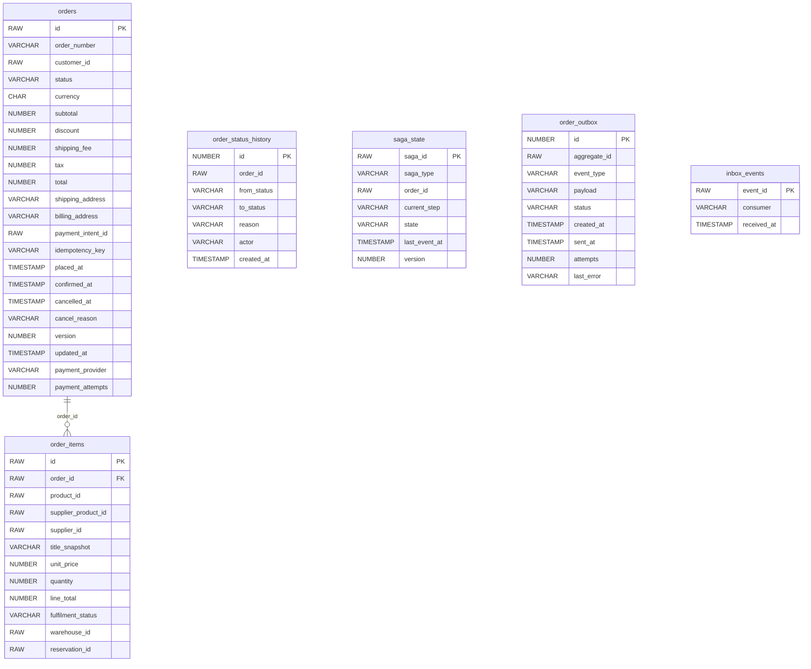

**`orders`** (`V1__create_order_schema.sql`)

| Column | Type and rules | Key |
|---|---|---|
| `id` | RAW(16) NOT NULL | PK |
| `order_number` | VARCHAR2(20) NOT NULL |  |
| `customer_id` | RAW(16) NOT NULL |  |
| `status` | VARCHAR2(30) DEFAULT 'CREATED' NOT NULL |  |
| `currency` | CHAR(3) NOT NULL |  |
| `subtotal` | NUMBER(19,4) NOT NULL |  |
| `discount` | NUMBER(19,4) DEFAULT 0 NOT NULL |  |
| `shipping_fee` | NUMBER(19,4) DEFAULT 0 NOT NULL |  |
| `tax` | NUMBER(19,4) DEFAULT 0 NOT NULL |  |
| `total` | NUMBER(19,4) NOT NULL |  |
| `shipping_address` | VARCHAR2(4000) NOT NULL |  |
| `billing_address` | VARCHAR2(4000) |  |
| `payment_intent_id` | RAW(16) |  |
| `idempotency_key` | VARCHAR2(80) NOT NULL |  |
| `placed_at` | TIMESTAMP NOT NULL |  |
| `confirmed_at` | TIMESTAMP |  |
| `cancelled_at` | TIMESTAMP |  |
| `cancel_reason` | VARCHAR2(200) |  |
| `version` | NUMBER(19) DEFAULT 0 NOT NULL |  |
| `updated_at` | TIMESTAMP NOT NULL |  |
| `payment_provider` | VARCHAR2(20) |  |
| `payment_attempts` | NUMBER(10) DEFAULT 1 NOT NULL |  |

Constraints: `uq_orders_number UNIQUE (order_number)`; `uq_orders_idempotency UNIQUE (idempotency_key, customer_id)`; `ck_orders_status CHECK (status IN ('CREATED','PAYMENT_PENDING','CONFIRMED','PARTIALLY_SHIPPED', 'SHIPPED','DELIVERED','CANCELLED','RETURNED','FAILED'))`

**`order_items`** (`V1__create_order_schema.sql`)

| Column | Type and rules | Key |
|---|---|---|
| `id` | RAW(16) NOT NULL | PK |
| `order_id` | RAW(16) NOT NULL | FK to `orders` |
| `product_id` | RAW(16) NOT NULL |  |
| `supplier_product_id` | RAW(16) NOT NULL |  |
| `supplier_id` | RAW(16) NOT NULL |  |
| `title_snapshot` | VARCHAR2(500) NOT NULL |  |
| `unit_price` | NUMBER(19,4) NOT NULL |  |
| `quantity` | NUMBER(10) NOT NULL CHECK (quantity > 0) |  |
| `line_total` | NUMBER(19,4) NOT NULL |  |
| `fulfilment_status` | VARCHAR2(30) DEFAULT 'PENDING' NOT NULL |  |
| `warehouse_id` | RAW(16) |  |
| `reservation_id` | RAW(16) |  |

Constraints: `fk_oi_order FOREIGN KEY (order_id) REFERENCES orders (id)`; `ck_oi_fulfilment CHECK (fulfilment_status IN ('PENDING','RESERVED','PACKED','SHIPPED','DELIVERED', 'CANCELLED','RETURNED'))`

**`order_status_history`** (`V1__create_order_schema.sql`)

| Column | Type and rules | Key |
|---|---|---|
| `id` | NUMBER(19) GENERATED BY DEFAULT AS IDENTITY PRIMARY KEY | PK |
| `order_id` | RAW(16) NOT NULL |  |
| `from_status` | VARCHAR2(30) |  |
| `to_status` | VARCHAR2(30) NOT NULL |  |
| `reason` | VARCHAR2(200) |  |
| `actor` | VARCHAR2(80) |  |
| `created_at` | TIMESTAMP NOT NULL |  |

**`saga_state`** (`V1__create_order_schema.sql`)

| Column | Type and rules | Key |
|---|---|---|
| `saga_id` | RAW(16) NOT NULL | PK |
| `saga_type` | VARCHAR2(40) NOT NULL |  |
| `order_id` | RAW(16) NOT NULL |  |
| `current_step` | VARCHAR2(60) NOT NULL |  |
| `state` | VARCHAR2(20) NOT NULL |  |
| `last_event_at` | TIMESTAMP NOT NULL |  |
| `version` | NUMBER(19) DEFAULT 0 NOT NULL |  |

Constraints: `uq_saga_order UNIQUE (order_id)`

**`order_outbox`** (`V1__create_order_schema.sql`)

| Column | Type and rules | Key |
|---|---|---|
| `id` | NUMBER(19) GENERATED BY DEFAULT AS IDENTITY PRIMARY KEY | PK |
| `aggregate_id` | RAW(16) NOT NULL |  |
| `event_type` | VARCHAR2(60) NOT NULL |  |
| `payload` | VARCHAR2(4000) NOT NULL |  |
| `status` | VARCHAR2(20) DEFAULT 'PENDING' NOT NULL |  |
| `created_at` | TIMESTAMP NOT NULL |  |
| `sent_at` | TIMESTAMP |  |
| `attempts` | NUMBER(10) DEFAULT 0 NOT NULL |  |
| `last_error` | VARCHAR2(1000) |  |

**`inbox_events`** (`V2__outbox_relay_and_inbox.sql`)

| Column | Type and rules | Key |
|---|---|---|
| `event_id` | RAW(16) NOT NULL | PK |
| `consumer` | VARCHAR2(60) NOT NULL |  |
| `received_at` | TIMESTAMP NOT NULL |  |

### Schema `PAYMENT` (payment-service)

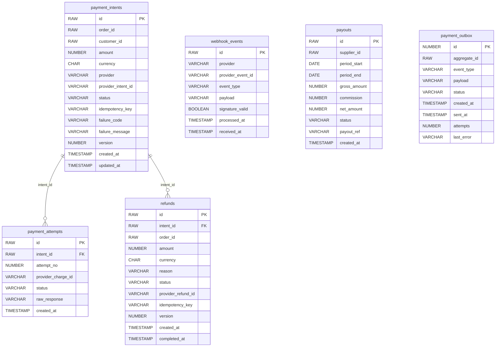

**`payment_intents`** (`V1__create_payment_schema.sql`)

| Column | Type and rules | Key |
|---|---|---|
| `id` | RAW(16) PRIMARY KEY | PK |
| `order_id` | RAW(16) NOT NULL |  |
| `customer_id` | RAW(16) NOT NULL |  |
| `amount` | NUMBER(19,4) NOT NULL CHECK (amount > 0) |  |
| `currency` | CHAR(3) NOT NULL |  |
| `provider` | VARCHAR2(20) NOT NULL CHECK (provider IN ('STRIPE','RAZORPAY')) |  |
| `provider_intent_id` | VARCHAR2(120) |  |
| `status` | VARCHAR2(30) DEFAULT 'INITIATED' NOT NULL CHECK (status IN ('INITIATED','REQUIRES_ACTION','AUTHORIZED','CAPTURED','FAILED','CANCELLED','REFUNDED','PARTIALLY_REFUNDED')) |  |
| `idempotency_key` | VARCHAR2(80) NOT NULL |  |
| `failure_code` | VARCHAR2(60) |  |
| `failure_message` | VARCHAR2(500) |  |
| `version` | NUMBER(19) DEFAULT 0 NOT NULL |  |
| `created_at` | TIMESTAMP WITH TIME ZONE DEFAULT CURRENT_TIMESTAMP NOT NULL |  |
| `updated_at` | TIMESTAMP WITH TIME ZONE DEFAULT CURRENT_TIMESTAMP NOT NULL |  |

Constraints: `uq_pi_idempotency_key UNIQUE (idempotency_key)`; `uq_pi_provider_intent UNIQUE (provider_intent_id)`

**`payment_attempts`** (`V1__create_payment_schema.sql`)

| Column | Type and rules | Key |
|---|---|---|
| `id` | RAW(16) PRIMARY KEY | PK |
| `intent_id` | RAW(16) NOT NULL ON DELETE CASCADE | FK to `payment_intents` |
| `attempt_no` | NUMBER(10) NOT NULL |  |
| `provider_charge_id` | VARCHAR2(120) |  |
| `status` | VARCHAR2(30) NOT NULL |  |
| `raw_response` | VARCHAR2(32767) |  |
| `created_at` | TIMESTAMP WITH TIME ZONE DEFAULT CURRENT_TIMESTAMP NOT NULL |  |

Constraints: `uq_attempt_no UNIQUE (intent_id, attempt_no)`

**`refunds`** (`V1__create_payment_schema.sql`)

| Column | Type and rules | Key |
|---|---|---|
| `id` | RAW(16) PRIMARY KEY | PK |
| `intent_id` | RAW(16) NOT NULL | FK to `payment_intents` |
| `order_id` | RAW(16) NOT NULL |  |
| `amount` | NUMBER(19,4) NOT NULL CHECK (amount > 0) |  |
| `currency` | CHAR(3) NOT NULL |  |
| `reason` | VARCHAR2(200) |  |
| `status` | VARCHAR2(30) DEFAULT 'INITIATED' NOT NULL CHECK (status IN ('INITIATED','PROCESSING','SUCCESS','FAILED')) |  |
| `provider_refund_id` | VARCHAR2(120) |  |
| `idempotency_key` | VARCHAR2(80) NOT NULL |  |
| `version` | NUMBER(19) DEFAULT 0 NOT NULL |  |
| `created_at` | TIMESTAMP WITH TIME ZONE DEFAULT CURRENT_TIMESTAMP NOT NULL |  |
| `completed_at` | TIMESTAMP WITH TIME ZONE |  |

Constraints: `uq_refund_idempotency_key UNIQUE (idempotency_key)`

**`webhook_events`** (`V1__create_payment_schema.sql`)

| Column | Type and rules | Key |
|---|---|---|
| `id` | RAW(16) PRIMARY KEY | PK |
| `provider` | VARCHAR2(20) NOT NULL |  |
| `provider_event_id` | VARCHAR2(120) NOT NULL |  |
| `event_type` | VARCHAR2(60) NOT NULL |  |
| `payload` | VARCHAR2(32767) NOT NULL |  |
| `signature_valid` | BOOLEAN NOT NULL |  |
| `processed_at` | TIMESTAMP WITH TIME ZONE |  |
| `received_at` | TIMESTAMP WITH TIME ZONE DEFAULT CURRENT_TIMESTAMP NOT NULL |  |

Constraints: `uq_webhook_event UNIQUE (provider, provider_event_id)`

**`payouts`** (`V1__create_payment_schema.sql`)

| Column | Type and rules | Key |
|---|---|---|
| `id` | RAW(16) PRIMARY KEY | PK |
| `supplier_id` | RAW(16) NOT NULL |  |
| `period_start` | DATE NOT NULL |  |
| `period_end` | DATE NOT NULL |  |
| `gross_amount` | NUMBER(19,4) NOT NULL |  |
| `commission` | NUMBER(19,4) NOT NULL |  |
| `net_amount` | NUMBER(19,4) NOT NULL |  |
| `status` | VARCHAR2(30) DEFAULT 'PENDING' NOT NULL |  |
| `payout_ref` | VARCHAR2(120) |  |
| `created_at` | TIMESTAMP WITH TIME ZONE DEFAULT CURRENT_TIMESTAMP NOT NULL |  |

**`payment_outbox`** (`V1__create_payment_schema.sql`)

| Column | Type and rules | Key |
|---|---|---|
| `id` | NUMBER(19) GENERATED BY DEFAULT AS IDENTITY PRIMARY KEY | PK |
| `aggregate_id` | RAW(16) NOT NULL |  |
| `event_type` | VARCHAR2(60) NOT NULL |  |
| `payload` | VARCHAR2(32767) NOT NULL |  |
| `status` | VARCHAR2(20) DEFAULT 'PENDING' NOT NULL |  |
| `created_at` | TIMESTAMP WITH TIME ZONE DEFAULT CURRENT_TIMESTAMP NOT NULL |  |
| `sent_at` | TIMESTAMP WITH TIME ZONE |  |
| `attempts` | NUMBER(10) DEFAULT 0 NOT NULL |  |
| `last_error` | VARCHAR2(1000) |  |

### Schema `CART` (cart-service)

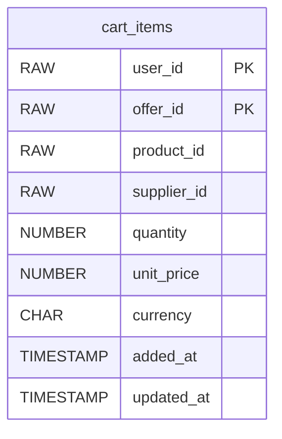

**`cart_items`** (`V1__create_cart_schema.sql`)

| Column | Type and rules | Key |
|---|---|---|
| `user_id` | RAW(16) NOT NULL | PK |
| `offer_id` | RAW(16) NOT NULL | PK |
| `product_id` | RAW(16) NOT NULL |  |
| `supplier_id` | RAW(16) NOT NULL |  |
| `quantity` | NUMBER(10) NOT NULL CHECK (quantity > 0) |  |
| `unit_price` | NUMBER(19,4) NOT NULL |  |
| `currency` | CHAR(3) NOT NULL |  |
| `added_at` | TIMESTAMP DEFAULT CURRENT_TIMESTAMP NOT NULL |  |
| `updated_at` | TIMESTAMP DEFAULT CURRENT_TIMESTAMP NOT NULL |  |

Constraints: `uq_cart_items_product UNIQUE (user_id, product_id)`

### Schema `PRODUCT` (product-service)

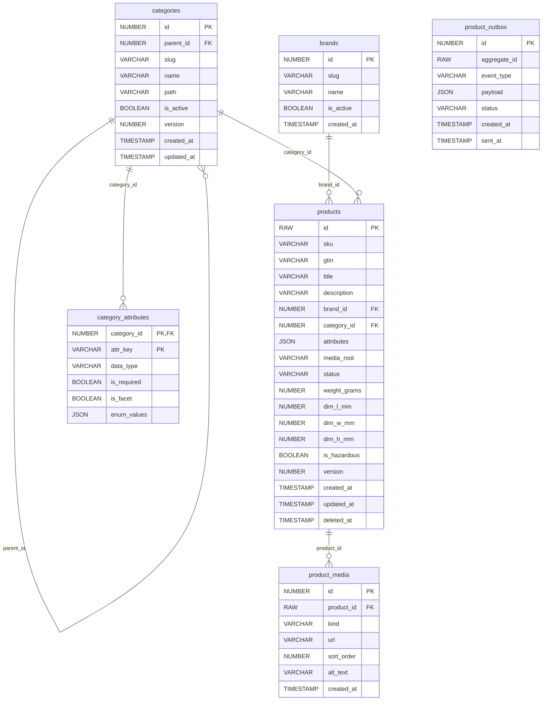

**`categories`** (`V1__create_product_schema.sql`)

| Column | Type and rules | Key |
|---|---|---|
| `id` | NUMBER(19) GENERATED BY DEFAULT AS IDENTITY PRIMARY KEY | PK |
| `parent_id` | NUMBER(19) | FK to `categories` |
| `slug` | VARCHAR2(120) NOT NULL UNIQUE |  |
| `name` | VARCHAR2(160) NOT NULL |  |
| `path` | VARCHAR2(1000) NOT NULL |  |
| `is_active` | BOOLEAN DEFAULT TRUE NOT NULL |  |
| `version` | NUMBER(19) DEFAULT 0 NOT NULL |  |
| `created_at` | TIMESTAMP WITH TIME ZONE DEFAULT CURRENT_TIMESTAMP NOT NULL |  |
| `updated_at` | TIMESTAMP WITH TIME ZONE DEFAULT CURRENT_TIMESTAMP NOT NULL |  |

**`brands`** (`V1__create_product_schema.sql`)

| Column | Type and rules | Key |
|---|---|---|
| `id` | NUMBER(19) GENERATED BY DEFAULT AS IDENTITY PRIMARY KEY | PK |
| `slug` | VARCHAR2(120) NOT NULL UNIQUE |  |
| `name` | VARCHAR2(160) NOT NULL |  |
| `is_active` | BOOLEAN DEFAULT TRUE NOT NULL |  |
| `created_at` | TIMESTAMP WITH TIME ZONE DEFAULT CURRENT_TIMESTAMP NOT NULL |  |

**`products`** (`V1__create_product_schema.sql`)

| Column | Type and rules | Key |
|---|---|---|
| `id` | RAW(16) DEFAULT SYS_GUID() PRIMARY KEY | PK |
| `sku` | VARCHAR2(64) NOT NULL |  |
| `gtin` | VARCHAR2(20) |  |
| `title` | VARCHAR2(500) NOT NULL |  |
| `description` | VARCHAR2(32767) |  |
| `brand_id` | NUMBER(19) | FK to `brands` |
| `category_id` | NUMBER(19) NOT NULL | FK to `categories` |
| `attributes` | JSON DEFAULT '{}' NOT NULL |  |
| `media_root` | VARCHAR2(500) |  |
| `status` | VARCHAR2(20) DEFAULT 'DRAFT' NOT NULL CHECK (status IN ('DRAFT','ACTIVE','HIDDEN','DELISTED')) |  |
| `weight_grams` | NUMBER(10) |  |
| `dim_l_mm` | NUMBER(10) |  |
| `dim_w_mm` | NUMBER(10) |  |
| `dim_h_mm` | NUMBER(10) |  |
| `is_hazardous` | BOOLEAN DEFAULT FALSE NOT NULL |  |
| `version` | NUMBER(19) DEFAULT 0 NOT NULL |  |
| `created_at` | TIMESTAMP WITH TIME ZONE DEFAULT CURRENT_TIMESTAMP NOT NULL |  |
| `updated_at` | TIMESTAMP WITH TIME ZONE DEFAULT CURRENT_TIMESTAMP NOT NULL |  |
| `deleted_at` | TIMESTAMP WITH TIME ZONE |  |

**`product_media`** (`V1__create_product_schema.sql`)

| Column | Type and rules | Key |
|---|---|---|
| `id` | NUMBER(19) GENERATED BY DEFAULT AS IDENTITY PRIMARY KEY | PK |
| `product_id` | RAW(16) NOT NULL ON DELETE CASCADE | FK to `products` |
| `kind` | VARCHAR2(20) NOT NULL CHECK (kind IN ('IMAGE','VIDEO','DOCUMENT')) |  |
| `url` | VARCHAR2(1000) NOT NULL |  |
| `sort_order` | NUMBER(10) DEFAULT 0 NOT NULL |  |
| `alt_text` | VARCHAR2(255) |  |
| `created_at` | TIMESTAMP WITH TIME ZONE DEFAULT CURRENT_TIMESTAMP NOT NULL |  |

**`category_attributes`** (`V1__create_product_schema.sql`)

| Column | Type and rules | Key |
|---|---|---|
| `category_id` | NUMBER(19) NOT NULL ON DELETE CASCADE | PK, FK to `categories` |
| `attr_key` | VARCHAR2(60) NOT NULL | PK |
| `data_type` | VARCHAR2(20) NOT NULL CHECK (data_type IN ('STRING','NUMBER','BOOL','ENUM')) |  |
| `is_required` | BOOLEAN DEFAULT FALSE NOT NULL |  |
| `is_facet` | BOOLEAN DEFAULT FALSE NOT NULL |  |
| `enum_values` | JSON |  |

**`product_outbox`** (`V1__create_product_schema.sql`)

| Column | Type and rules | Key |
|---|---|---|
| `id` | NUMBER(19) GENERATED BY DEFAULT AS IDENTITY PRIMARY KEY | PK |
| `aggregate_id` | RAW(16) NOT NULL |  |
| `event_type` | VARCHAR2(60) NOT NULL |  |
| `payload` | JSON NOT NULL |  |
| `status` | VARCHAR2(20) DEFAULT 'PENDING' NOT NULL |  |
| `created_at` | TIMESTAMP WITH TIME ZONE DEFAULT CURRENT_TIMESTAMP NOT NULL |  |
| `sent_at` | TIMESTAMP WITH TIME ZONE |  |

### Schema `INVENTORY` (inventory-manager)

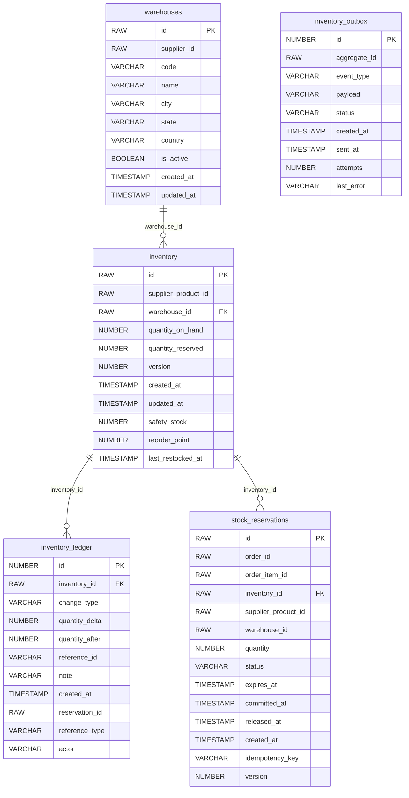

**`warehouses`** (`V1__create_inventory_schema.sql`)

| Column | Type and rules | Key |
|---|---|---|
| `id` | RAW(16) PRIMARY KEY | PK |
| `supplier_id` | RAW(16) NOT NULL |  |
| `code` | VARCHAR2(50) NOT NULL |  |
| `name` | VARCHAR2(100) NOT NULL |  |
| `city` | VARCHAR2(100) |  |
| `state` | VARCHAR2(100) |  |
| `country` | VARCHAR2(100) |  |
| `is_active` | BOOLEAN DEFAULT TRUE NOT NULL |  |
| `created_at` | TIMESTAMP DEFAULT CURRENT_TIMESTAMP NOT NULL |  |
| `updated_at` | TIMESTAMP DEFAULT CURRENT_TIMESTAMP NOT NULL |  |

**`inventory`** (`V1__create_inventory_schema.sql`)

| Column | Type and rules | Key |
|---|---|---|
| `id` | RAW(16) PRIMARY KEY | PK |
| `supplier_product_id` | RAW(16) NOT NULL |  |
| `warehouse_id` | RAW(16) NOT NULL | FK to `warehouses` |
| `quantity_on_hand` | NUMBER(10) NOT NULL CHECK (quantity_on_hand >= 0) |  |
| `quantity_reserved` | NUMBER(10) DEFAULT 0 NOT NULL CHECK (quantity_reserved >= 0) |  |
| `version` | NUMBER(19) DEFAULT 0 NOT NULL |  |
| `created_at` | TIMESTAMP DEFAULT CURRENT_TIMESTAMP NOT NULL |  |
| `updated_at` | TIMESTAMP DEFAULT CURRENT_TIMESTAMP NOT NULL |  |
| `safety_stock` | NUMBER(10) DEFAULT 0 NOT NULL |  |
| `reorder_point` | NUMBER(10) DEFAULT 0 NOT NULL |  |
| `last_restocked_at` | TIMESTAMP |  |

Constraints: `fk_inventory_warehouse FOREIGN KEY (warehouse_id) REFERENCES warehouses(id)`; `uq_supplier_product_warehouse UNIQUE (supplier_product_id, warehouse_id)`

**`stock_reservations`** (`V1__create_inventory_schema.sql`)

| Column | Type and rules | Key |
|---|---|---|
| `id` | RAW(16) PRIMARY KEY | PK |
| `order_id` | RAW(16) NOT NULL |  |
| `order_item_id` | RAW(16) NOT NULL |  |
| `inventory_id` | RAW(16) NOT NULL | FK to `inventory` |
| `supplier_product_id` | RAW(16) NOT NULL |  |
| `warehouse_id` | RAW(16) NOT NULL |  |
| `quantity` | NUMBER(10) NOT NULL CHECK (quantity > 0) |  |
| `status` | VARCHAR2(20) NOT NULL |  |
| `expires_at` | TIMESTAMP |  |
| `committed_at` | TIMESTAMP |  |
| `released_at` | TIMESTAMP |  |
| `created_at` | TIMESTAMP DEFAULT CURRENT_TIMESTAMP NOT NULL |  |
| `idempotency_key` | VARCHAR2(80) |  |
| `version` | NUMBER(19) DEFAULT 0 NOT NULL |  |

Constraints: `fk_reservation_inventory FOREIGN KEY (inventory_id) REFERENCES inventory(id)`; `uq_reservation_idempotency_key UNIQUE (idempotency_key`

**`inventory_ledger`** (`V1__create_inventory_schema.sql`)

| Column | Type and rules | Key |
|---|---|---|
| `id` | NUMBER(19) GENERATED BY DEFAULT AS IDENTITY PRIMARY KEY | PK |
| `inventory_id` | RAW(16) NOT NULL | FK to `inventory` |
| `change_type` | VARCHAR2(50) NOT NULL |  |
| `quantity_delta` | NUMBER(10) NOT NULL |  |
| `quantity_after` | NUMBER(10) NOT NULL |  |
| `reference_id` | VARCHAR2(100) |  |
| `note` | VARCHAR2(255) |  |
| `created_at` | TIMESTAMP DEFAULT CURRENT_TIMESTAMP NOT NULL |  |
| `reservation_id` | RAW(16) |  |
| `reference_type` | VARCHAR2(30) |  |
| `actor` | VARCHAR2(80) |  |

Constraints: `fk_ledger_inventory FOREIGN KEY (inventory_id) REFERENCES inventory(id)`

**`inventory_outbox`** (`V2__extend_inventory_schema.sql`)

| Column | Type and rules | Key |
|---|---|---|
| `id` | NUMBER(19) GENERATED BY DEFAULT AS IDENTITY PRIMARY KEY | PK |
| `aggregate_id` | RAW(16) NOT NULL |  |
| `event_type` | VARCHAR2(60) NOT NULL |  |
| `payload` | VARCHAR2(32767) NOT NULL |  |
| `status` | VARCHAR2(20) DEFAULT 'PENDING' NOT NULL |  |
| `created_at` | TIMESTAMP DEFAULT CURRENT_TIMESTAMP NOT NULL |  |
| `sent_at` | TIMESTAMP |  |
| `attempts` | NUMBER(10) DEFAULT 0 NOT NULL |  |
| `last_error` | VARCHAR2(1000) |  |

### Schema `SUPPLIER` (supplier-service)

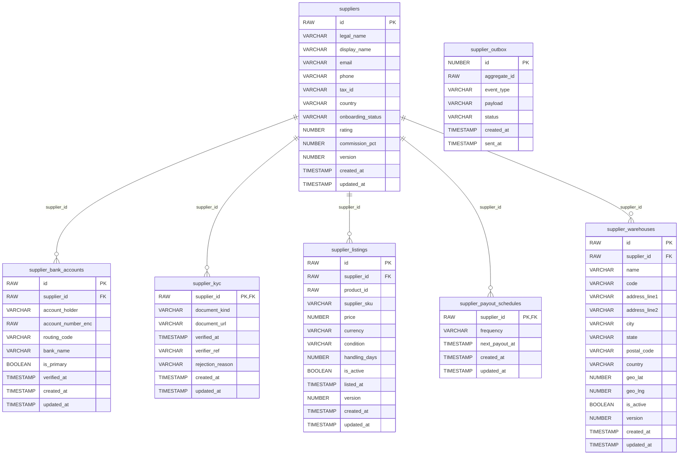

**`suppliers`** (`V1__create_supplier_schema.sql`)

| Column | Type and rules | Key |
|---|---|---|
| `id` | RAW(16) PRIMARY KEY | PK |
| `legal_name` | VARCHAR2(255) NOT NULL |  |
| `display_name` | VARCHAR2(160) NOT NULL |  |
| `email` | VARCHAR2(255) NOT NULL |  |
| `phone` | VARCHAR2(20) |  |
| `tax_id` | VARCHAR2(40) |  |
| `country` | VARCHAR2(2) NOT NULL |  |
| `onboarding_status` | VARCHAR2(30) DEFAULT 'PENDING' NOT NULL CHECK ( onboarding_status IN ( 'PENDING', 'KYC_SUBMITTED', 'APPROVED', 'REJECTED', 'SUSPENDED' ) ) |  |
| `rating` | NUMBER(3,2) DEFAULT 0.00 NOT NULL CHECK (rating >= 0 AND rating <= 5) |  |
| `commission_pct` | NUMBER(5,2) DEFAULT 10.00 NOT NULL CHECK (commission_pct >= 0 AND commission_pct <= 100) |  |
| `version` | NUMBER(19) DEFAULT 0 NOT NULL |  |
| `created_at` | TIMESTAMP WITH TIME ZONE DEFAULT CURRENT_TIMESTAMP NOT NULL |  |
| `updated_at` | TIMESTAMP WITH TIME ZONE DEFAULT CURRENT_TIMESTAMP NOT NULL |  |

Constraints: `CHECK (INSTR(email, '@') > 1)`

**`supplier_kyc`** (`V1__create_supplier_schema.sql`)

| Column | Type and rules | Key |
|---|---|---|
| `supplier_id` | RAW(16) PRIMARY KEY ON DELETE CASCADE | PK, FK to `suppliers` |
| `document_kind` | VARCHAR2(40) NOT NULL |  |
| `document_url` | VARCHAR2(1000) NOT NULL |  |
| `verified_at` | TIMESTAMP WITH TIME ZONE |  |
| `verifier_ref` | VARCHAR2(120) |  |
| `rejection_reason` | VARCHAR2(4000) |  |
| `created_at` | TIMESTAMP WITH TIME ZONE DEFAULT CURRENT_TIMESTAMP NOT NULL |  |
| `updated_at` | TIMESTAMP WITH TIME ZONE DEFAULT CURRENT_TIMESTAMP NOT NULL |  |

**`supplier_bank_accounts`** (`V1__create_supplier_schema.sql`)

| Column | Type and rules | Key |
|---|---|---|
| `id` | RAW(16) PRIMARY KEY | PK |
| `supplier_id` | RAW(16) NOT NULL ON DELETE CASCADE | FK to `suppliers` |
| `account_holder` | VARCHAR2(160) NOT NULL |  |
| `account_number_enc` | RAW(2000) NOT NULL |  |
| `routing_code` | VARCHAR2(40) |  |
| `bank_name` | VARCHAR2(120) |  |
| `is_primary` | BOOLEAN DEFAULT TRUE NOT NULL |  |
| `verified_at` | TIMESTAMP WITH TIME ZONE |  |
| `created_at` | TIMESTAMP WITH TIME ZONE DEFAULT CURRENT_TIMESTAMP NOT NULL |  |
| `updated_at` | TIMESTAMP WITH TIME ZONE DEFAULT CURRENT_TIMESTAMP NOT NULL |  |

**`supplier_warehouses`** (`V1__create_supplier_schema.sql`)

| Column | Type and rules | Key |
|---|---|---|
| `id` | RAW(16) PRIMARY KEY | PK |
| `supplier_id` | RAW(16) NOT NULL ON DELETE CASCADE | FK to `suppliers` |
| `name` | VARCHAR2(120) NOT NULL |  |
| `code` | VARCHAR2(40) NOT NULL |  |
| `address_line1` | VARCHAR2(200) NOT NULL |  |
| `address_line2` | VARCHAR2(200) |  |
| `city` | VARCHAR2(100) NOT NULL |  |
| `state` | VARCHAR2(100) NOT NULL |  |
| `postal_code` | VARCHAR2(20) NOT NULL |  |
| `country` | VARCHAR2(2) NOT NULL |  |
| `geo_lat` | NUMBER(9,6) CHECK (geo_lat BETWEEN -90 AND 90) |  |
| `geo_lng` | NUMBER(9,6) CHECK (geo_lng BETWEEN -180 AND 180) |  |
| `is_active` | BOOLEAN DEFAULT TRUE NOT NULL |  |
| `version` | NUMBER(19) DEFAULT 0 NOT NULL |  |
| `created_at` | TIMESTAMP WITH TIME ZONE DEFAULT CURRENT_TIMESTAMP NOT NULL |  |
| `updated_at` | TIMESTAMP WITH TIME ZONE DEFAULT CURRENT_TIMESTAMP NOT NULL |  |

Constraints: `uq_supplier_warehouse_code UNIQUE (supplier_id, code)`

**`supplier_listings`** (`V1__create_supplier_schema.sql`)

| Column | Type and rules | Key |
|---|---|---|
| `id` | RAW(16) PRIMARY KEY | PK |
| `supplier_id` | RAW(16) NOT NULL | FK to `suppliers` |
| `product_id` | RAW(16) NOT NULL |  |
| `supplier_sku` | VARCHAR2(80) NOT NULL |  |
| `price` | NUMBER(19,4) NOT NULL CHECK (price > 0) |  |
| `currency` | VARCHAR2(3) DEFAULT 'INR' NOT NULL |  |
| `condition` | VARCHAR2(20) DEFAULT 'NEW' NOT NULL CHECK ( condition IN ( 'NEW', 'REFURBISHED', 'USED_LIKE_NEW', 'USED_GOOD' ) ) |  |
| `handling_days` | NUMBER(5) DEFAULT 1 NOT NULL CHECK (handling_days >= 0) |  |
| `is_active` | BOOLEAN DEFAULT TRUE NOT NULL |  |
| `listed_at` | TIMESTAMP WITH TIME ZONE DEFAULT CURRENT_TIMESTAMP NOT NULL |  |
| `version` | NUMBER(19) DEFAULT 0 NOT NULL |  |
| `created_at` | TIMESTAMP WITH TIME ZONE DEFAULT CURRENT_TIMESTAMP NOT NULL |  |
| `updated_at` | TIMESTAMP WITH TIME ZONE DEFAULT CURRENT_TIMESTAMP NOT NULL |  |

**`supplier_payout_schedules`** (`V1__create_supplier_schema.sql`)

| Column | Type and rules | Key |
|---|---|---|
| `supplier_id` | RAW(16) PRIMARY KEY ON DELETE CASCADE | PK, FK to `suppliers` |
| `frequency` | VARCHAR2(20) DEFAULT 'WEEKLY' NOT NULL CHECK ( frequency IN ( 'DAILY', 'WEEKLY', 'MONTHLY' ) ) |  |
| `next_payout_at` | TIMESTAMP WITH TIME ZONE |  |
| `created_at` | TIMESTAMP WITH TIME ZONE DEFAULT CURRENT_TIMESTAMP NOT NULL |  |
| `updated_at` | TIMESTAMP WITH TIME ZONE DEFAULT CURRENT_TIMESTAMP NOT NULL |  |

**`supplier_outbox`** (`V1__create_supplier_schema.sql`)

| Column | Type and rules | Key |
|---|---|---|
| `id` | NUMBER(19) GENERATED BY DEFAULT AS IDENTITY PRIMARY KEY | PK |
| `aggregate_id` | RAW(16) NOT NULL |  |
| `event_type` | VARCHAR2(60) NOT NULL |  |
| `payload` | VARCHAR2(32767) NOT NULL |  |
| `status` | VARCHAR2(20) DEFAULT 'PENDING' NOT NULL CHECK ( status IN ( 'PENDING', 'SENT', 'FAILED' ) ) |  |
| `created_at` | TIMESTAMP WITH TIME ZONE DEFAULT CURRENT_TIMESTAMP NOT NULL |  |
| `sent_at` | TIMESTAMP WITH TIME ZONE |  |


---

## 9. Web consoles

Plain HTML, CSS and JavaScript pages served by the services themselves (iOS-style motion, light and dark themes, phone layout).

| Page | URL | Who | What it does |
|---|---|---|---|
| ShopTrail Accounts | `user-service/console.html` | everyone | Sign up, sign in, profile, addresses, payment methods, consent, security, admin tab for ADMIN/OPS, email links `?verify=` and `?reset=` |
| ShopTrail Orders | `order-service/console.html` | signed-in customers | Catalogue, cart, place order, pay with Stripe test methods or Razorpay Checkout, live order timeline |
| ShopTrail Sellers | `supplier-service/supplier.html` | SUPPLIER, OPS, ADMIN | Supplier, warehouses, products, offers, stock upload, in the dependency order of section 6.6 |

Each page keeps its own session in `localStorage` (one sign-in per site). The User service address is a field on the sign-in card and defaults to the deployed user-service.

**Test payments (no real money):** Stripe tokens `pm_card_visa` (succeeds), `pm_card_chargeDeclined` (declined); Razorpay card `4100 2800 0000 1007`, expiry `12/26`, CVV `123`, or UPI `test@razorpay`.

---

## 10. Known gaps

| Gap | Effect |
|---|---|
| Only user-service checks tokens | cart, order, payment, product, inventory and supplier trust `X-User-Id` and accept anyone. The seller-portal role check is UI only. Next step: validate the JWT against `/.well-known/jwks.json` in each service and require roles on write endpoints. |
| No Redis in production | Login and reset rate limits are skipped; the profile cache is off. |
| Supplier and product events are not relayed | `supplier_outbox` and `product_outbox` rows are written but not published. |
| Shipping, returns and payouts | Statuses and tables exist (`SHIPPED`, `DELIVERED`, `RETURNED`, `payouts`, `supplier_payout_schedules`, `supplier_bank_accounts`) but no flow uses them. |
| Duplicate mails possible | Kafka delivery is at least once, so a redelivered `ORDER_CONFIRMED` can send the mail twice. |
| `domain.user.events` has no consumer | Events are published for future use. |
